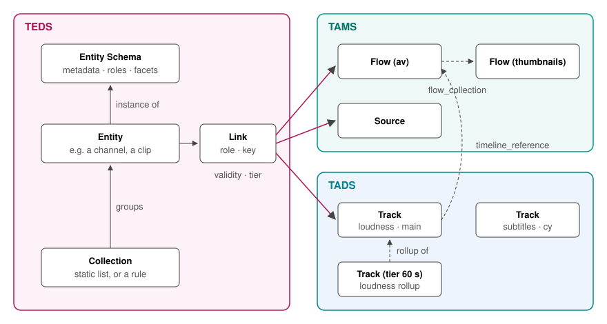

# Typed Entity Data Store API

TEDS, the Typed Entity Data Store, is designed to sit alongside [TAMS](https://github.com/bbc/tams) and [TADS](https://github.com/bbc/tads).
TAMS stores media on a timeline, and TADS stores data on a timeline.
TEDS records the *things* that media and data belong to (a channel, a clip, a programme) and which flows and tracks serve each of them.

> [!CAUTION]
> TEDS is at an early stage of development and should be considered an Alpha.
> It should not be used in production, and core aspects will change frequently in the short term.

## Documentation

- [OpenAPI Specification](./api/TypedEntityDataStore.yaml)
- Rendered Specification: `make render`, then open `api/docs/index.html`
- [Supporting Documentation (Application Notes and Decision Records)](./docs/README.md)
- [Principles](./PRINCIPLES.md)

## TEDS is for the things media and data belong to

A recorded broadcast channel is not one thing in a media store.
It is a transport stream flow, a thumbnail flow, perhaps a proxy, and in a data store a loudness track, a subtitle track per language, an as-run programme timeline and more.
Each of those is registered separately, by the separate processes that produce them.
Nothing records that they are one channel, which roles each plays, or which of them to use at a given moment.

Every application that needs the answer ends up rebuilding it: listing flows and guessing from labels, deriving identifiers by convention, or keeping its own table.
Those answers disagree with each other, fail silently, and break when a recorder restarts onto a new flow.

TEDS is designed to:

- give the things media and data belong to a stable identity, described by a schema anyone can read
- record which TAMS flows and TADS tracks serve each entity, in which role, and over which time
- let those records be made automatically, from evidence the media and data stores already hold

## How TEDS works

Everything in TEDS is described by an uploaded, immutable **Entity Schema**.
A schema says what an entity of that type records about itself (its *metadata*, a JSON Schema) and which **roles** it expects to be linked to: the flow carrying its picture and sound, the track carrying its loudness, one subtitle track per language.

An **Entity** is an instance of a schema, validated against it on every write.
A **Link** connects an entity to a TAMS flow or source, or a TADS track, in a role, optionally for a **key** (such as a subtitle language), over a **validity timerange**.
When a recorder restarts onto a new flow, the channel gains a second link from that moment on, and "the channel at time T" resolves to the right one.

Links can be written directly, but the intended way is for them to appear on their own.
A producer stamps what it writes with a few tags.
A process that derives from another flow copies the stamp forward.
TEDS reads the evidence TAMS and TADS already hold (flow collections, timeline references, derivation) and applies each schema's own linking rules.
See [AppNote 0003](./docs/appnotes/0003-registering-channels-automatically.md).

Entities can be grouped into **Collections**, which are static lists or rules such as "every channel whose provider is X".

Because a schema declares how each role is drawn on a timeline (a scalar, an interval, a run of text, a sequence of images), a viewer can show a channel's lanes without any per-channel configuration.

## What TEDS is not

- **Not a media or data store.**
  TEDS holds no media (that is TAMS) and no timed data (that is TADS).
- **Not an access-control system.**
  TEDS authenticates callers and records who changed what, but decides no rights.
  An access-control service in front of it narrows what each user sees using TEDS's own filters.
  See [AppNote 0005](./docs/appnotes/0005-composing-teds-with-an-access-control-service.md).
- **Not a workflow or ingest system.**
  It registers, links and finds things; it does not move or transform them.

## Open questions

TEDS is at an early stage, and these are the questions we are working through.

### Time

- TEDS links are bounded by TAMS timeranges.
  How should a deployment reconcile recorders whose timestamps are labelled UTC with the TAI timeline TAMS specifies?

### Linking

- Are the five link rules (declared, stamped, inferred by collection, by derivation, by timeline reference) sufficient, or do real deployments need others?
- Should a label-similarity *suggestion* ever be promoted automatically?

### Schemas

- Should there be a small set of shared, versioned entity schemas beyond the two core ones, for common broadcast entities such as programmes and services?
- How should an entity move between schema versions at scale?

## API Versioning

> [!CAUTION]
> While TEDS is in an alpha phase, the major version number remains `0`.
> Breaking changes may be made during this phase without incrementing the major version number.

The API is versioned using a major and minor version number, in the same way as TAMS and TADS.
A breaking change (such as the removal of a feature, or renaming a property in a way that breaks compatibility) results in a major version increment, and the minor version is reset to 0.
New features, such as new endpoints or new optional properties, result in a minor version increment.
Other changes, such as documentation changes, do not change the version.

Versions are calculated from strings included in commit messages:

- `sem-ver: api-break`: a breaking change (a major version bump)
- `sem-ver: feature`: a new feature (a minor version bump)
- `sem-ver: deprecation`: a feature marked as deprecated but not yet removed (a minor version bump)

Commits without one of these strings do not change the version.

The role vocabulary ([`vocabulary/roles.json`](./vocabulary/roles.json)) and the tag contract ([AppNote 0001](./docs/appnotes/0001-using-teds-with-tams-and-tads.md)) carry their own version numbers, reported by `GET /service`.

## Security

The TEDS specification sets out the authentication methods a client should support: HTTP Bearer tokens, a URL token, and HTTP Basic, as TADS does.
The authorisation model (the rules by which authenticated requests are allowed or denied) is not part of the TEDS specification.
It belongs to the implementer and the organisation, depending on their rules, needs and threat model.
[AppNote 0005](./docs/appnotes/0005-composing-teds-with-an-access-control-service.md) describes how an access-control service composes with TEDS.

Implementations are expected to apply other IT and cloud security best practice, notably TLS within and between systems.

## Proposals, Decisions and Architecture Changes

This repository uses [(M)ADR documents](https://adr.github.io/madr/) to propose significant changes, to support discussion and decision making, and to keep a record of the options that were considered.
They are in [docs/adr](./docs/adr/), and are managed as described by the [ADR Readme](./docs/adr/README.md).

## Development

The [Makefile](./Makefile) has targets to aid specification development.
They rely on Docker.

- `make lint`: lint the Markdown documents, validate the API specification, and run the specification checks (`tools/validate.py`)
- `make render`: bundle the specification and render it as HTML (at `api/docs/index.html`)
- `make conform-json`: rewrite every JSON file in the 4-space format the linter expects
- `make mock-server-up`: start a mock TEDS API on <http://localhost:4010/?access_token=fake>

The same checks run in the GitLab CI pipeline for every merge request.

## Repository layout

- [`api/`](./api/): the OpenAPI specification, its [schemas](./api/schemas/) and [examples](./api/examples/)
- [`entity-schemas/core/`](./entity-schemas/core/): the entity schemas every TEDS server ships
- [`entity-schemas/examples/`](./entity-schemas/examples/): example application schemas, and example entities
- [`vocabulary/roles.json`](./vocabulary/roles.json): the role vocabulary
- [`docs/`](./docs/): application notes, decision records and templates
- [`tools/validate.py`](./tools/validate.py): the specification checks

## Get in touch

TEDS is an alpha specification and will change rapidly in the short term.
To take part, raise an issue on this repository, or see [CONTRIBUTING.md](./CONTRIBUTING.md) for how to contribute.
